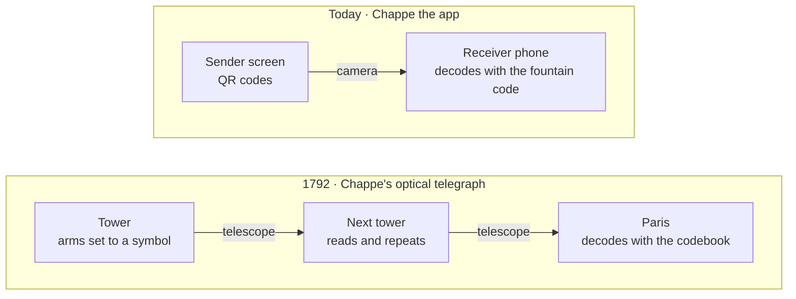
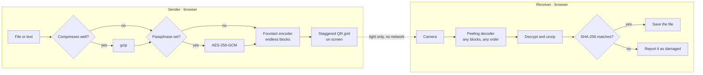
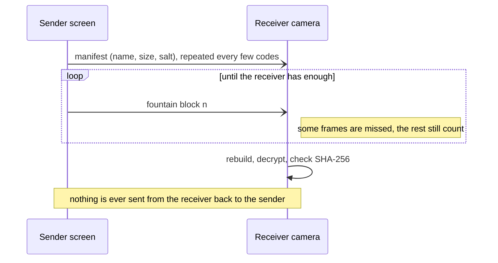

<p align="center">
  
</p>

<h1 align="center">Chappe</h1>

<p align="center">
  <b>Open-source file sharing over QR codes. Fully offline, end-to-end encrypted.</b>
</p>

<p align="center">
  Show a stream of QR codes on one screen, scan it with another device, and the
  file arrives. No internet, no server, no upload.
</p>

## What "Chappe" means

Claude Chappe (1763–1805) was a French engineer who built the **optical
telegraph**, first demonstrated in 1792. It was the first practical system for
sending messages across long distances **by sight**.

A line of towers stood on hilltops, each within telescope range of the next.
Every tower had movable wooden arms. An operator set the arms to a position
that stood for a symbol in a shared codebook. The operator at the next tower
read it through a telescope and repeated it. News from the front reached Paris
in hours instead of days, and the word *telegraph* ("far writer") was coined
for this system.

This app does the same thing 230 years later. The arms become QR codes, the
telescope becomes a phone camera, and the codebook becomes a fountain code.
Nothing travels over a wire or a network. The message moves as light.



## Why

Cloud sharing hands your file to a third party. Chappe never does. The file is
encoded in your browser and read back by the other device's camera. It works
with wifi off, so you can check for yourself that the data went nowhere but the
lens.

- No upload, no account, no server.
- Optional passphrase: AES-256-GCM (PBKDF2, 210k iterations) before the first code is drawn.
- SHA-256 check on arrival, so a damaged transfer is reported instead of saved.
- Nothing to install on the sending machine. It is a web page.

## How it works



The sender never waits for the receiver, and the receiver never talks back. It
joins whenever it likes, misses frames freely, and finishes once it has caught
enough blocks:



- **Fountain code (LT, systematic).** The sender streams an endless set of
  blocks. The receiver rebuilds the file from any sufficient subset, in any
  order, so missed frames cost a little time and never stall the transfer.
- **Staggered grid.** Up to nine codes on screen, changed one at a time, so the
  camera rarely catches a half-drawn frame.
- **Two decoders.** The browser's `BarcodeDetector` where it exists (Chrome on
  Android and macOS). Elsewhere, including iPhone, `jsQR` scans the whole frame
  plus four overlapping corner tiles to read each code in a 2 × 2 grid.
- **No network, enforced.** A `connect-src 'none'` Content Security Policy in
  the production build, plus a runtime guard that blocks and counts any request.
  The count is shown in the header.

## Develop

```bash
bun install
bun dev            # http://localhost:5173
bun test           # transport, crypto, codec and end-to-end QR tests
bun run typecheck
bun run lint
bun run build      # static site in dist/
```

The camera and Web Crypto need a secure context: `localhost` or https. To test
from a phone during development, serve the dev server over https.

## Deploy

`bun run build` produces a static `dist/` folder with no server code. Any
static host with https works: Cloudflare Pages or Vercel with build command
`bun run build` and output directory `dist`.

## Limits

- Files up to 5 MB. Larger files work in principle but take minutes to beam.
- The 3 × 3 grid needs a receiver with `BarcodeDetector` (Chrome on Android).
- Speed depends on the screen, the camera and the light. Start with the defaults.
